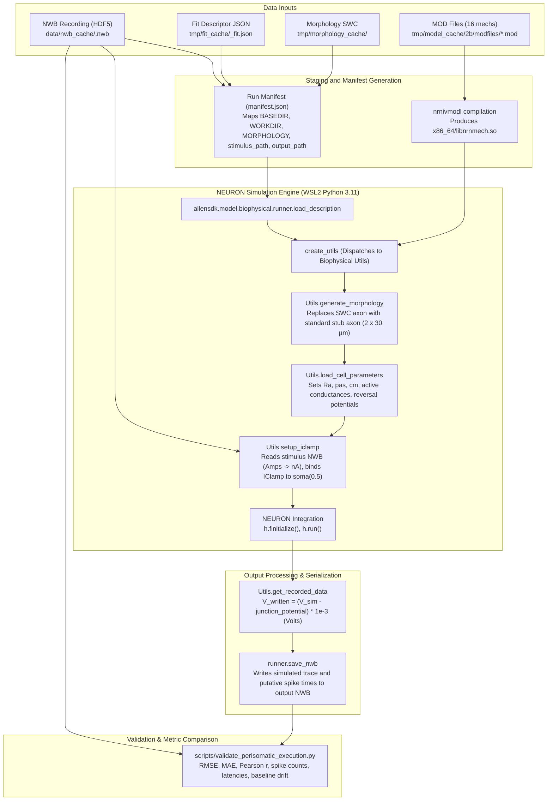

# Phase 3A — Execution Pipeline Trace: Detailed Biophysical Neuron Model

**Date:** 2026-11-08  
**Repository:** `Patel-Princy/INCM_project`  
**Active Working Branch:** `ashish-work`  
**Preceding Audit:** `results/phase3/PHASE3A_BASELINE_AUDIT.md`  

---

## 1. Executive Summary

This document traces the exact execution pipeline from raw experimental recording (NWB) and model fit descriptors to NEURON simulation execution, output serialization, and comparative feature validation. Every step is traced to verified source code in the repository and the validated AllenSDK 2.16.2 / NEURON 8.2.7 toolchain.

---

## 2. End-to-End Execution Architecture



---

## 3. Step-by-Step Execution Path Trace

### Step 1: NWB File Loading and Sweep Access
- **Source Path:** `allensdk/core/nwb_data_set.py`
- **Class / Function:** `allensdk.core.nwb_data_set.NwbDataSet.get_sweep(sweep_number)`
- **Inputs:** `sweep_number: int`
- **Outputs:** Dictionary:
  - `'stimulus'`: 1D `numpy.ndarray` (command current in Amperes, A)
  - `'response'`: 1D `numpy.ndarray` (membrane voltage in Volts, V)
  - `'sampling_rate'`: float (Hz, e.g. `200000.0` or `50000.0`)
  - `'index_range'`: 2-tuple of ints (start/end of valid experiment window)
- **Key Implementation Detail:**  
  Allen NWB files carry pipeline versioning (`general/generated_by`). In early pipeline files (version ≤ 1.0 or where the version token was unparsed by Python 3 byte-string comparison), raw data arrays were stored directly in SI units (Amps / Volts), while metadata attributes included `conversion=1e-12`. `NwbDataSet` checks pipeline version: if $\le 1.0$, it returns `stimulus_dataset[()]` unscaled. If $> 1.0$, it applies `stimulus_dataset[()] * conversion`.
- **Tests:** `tests/test_allen_inventory_units.py`, `scripts/validate_nwb_stimulus_units.py`.

---

### Step 2: Specimen and Sweep Identification
- **Source Path:** `src/data_audit/allen_inventory.py`, `src/data_audit/four_population_audit.py`, `src/data_audit/selected_model_readiness.py`
- **Inputs:** RMA API query results or cached metadata CSVs (`cell_inventory.csv`, `sweep_inventory.csv`).
- **Outputs:** Verified specimen IDs, sweep numbers, stimulus protocol tags (`C1LSCOARSE150216`, `C1LSFINEST150112`), and depolarizing step amplitudes.
- **Rules:**
  - Sweeps must belong to the long-square protocol family.
  - Fitting sweeps identified in the model fit descriptor are reserved exclusively for calibration; held-out sweeps must be strictly separated.

---

### Step 3: Stimulus Extraction & Segmentation
- **Source Path:** `scripts/validate_perisomatic_execution.py` (`_stimulus_segments`)
- **Inputs:** Raw stimulus vector (A), sampling time step $dt$ (ms).
- **Outputs:** Contiguous non-zero stimulus segments identifying:
  1. Initial short test pulse (~10–20 ms access resistance probe).
  2. Main long current step (~1000 ms depolarizing or hyperpolarizing step).
  - Attributes: `start_index`, `end_index`, `onset_ms`, `duration_ms`, `amplitude_pa`.

---

### Step 4: Current-Unit Conversion
- **Source Path:** `allensdk/model/biophysical/utils.py` (`Utils.read_stimulus`)
- **Conversion Formula:**
  $$\text{stim\_curr (nA)} = \text{sweep\_data['stimulus'] (A)} \times 1.0 \times 10^9$$
- **NEURON Target:** Assigned to `self.h.IClamp.amp` via NEURON Vector play:
  `self.stim_curr.play(self.stim._ref_amp, self.h.dt)`.
- **Verification:** Verified to match physical current amplitude in nanoamperes (nA).

---

### Step 5: Voltage-Unit Conversion and Junction Potential Correction
- **Source Path:** `allensdk/model/biophysical/utils.py` (`Utils.get_recorded_data`)
- **NEURON Native Unit:** Millivolts (mV).
- **Junction Potential Parameter:** Extracted from descriptor:
  `junction_potential = self.description.data['fitting'][0]['junction_potential']` (typically $-14.0\text{ mV}$).
- **Output Shift Formula:**
  $$V_{\text{written}} = \left(V_{\text{sim}} - \text{junction\_potential}\right) \times 10^{-3} = \left(V_{\text{sim}} - (-14.0\text{ mV})\right) \times 10^{-3}\text{ Volts}$$
- **Physical Rationale:** Real patch-clamp pipette measurements are subject to a liquid junction potential ($V_m = V_p - V_{ljp}$, where $V_{ljp} \approx +14\text{ mV}$). The unshifted recording $V_p$ was stored in the NWB file. Adding $+14\text{ mV}$ to the biophysical model output brings the simulation into the exact reference frame of the raw patch-clamp recording.

---

### Step 6: Baseline and Holding-Current Treatment
- **In-Recording Treatment:** Baseline voltage is computed over the quiet interval before the main current step (`|stimulus| <= 1e-12 A`, excluding the test pulse).
- **In-Simulation Treatment:** Initialized via `h.finitialize()` to $V_{\text{init}}$ (from `conditions[0]['v_init']`, typically $-79.0\text{ mV}$).

---

### Step 7: Morphology Loading and Axon Configuration
- **Source Path:** `allensdk/model/biophysical/utils.py` (`Utils.generate_morphology`)
- **Morphology Reader:** `neuron.h.Import3d_SWC_read()`, `neuron.h.Import3d_GUI`.
- **Perisomatic vs All-Active Axon Handling (CRITICAL DIFFERENCE):**
  - **Perisomatic Loader (`Utils.generate_morphology`):** Any axon branches present in the SWC reconstruction are explicitly deleted:
    ```python
    for sec in h.allsec():
        sec.nseg = 1 + 2 * int(sec.L / 40.0)
        if sec.name()[:4] == "axon":
            h.delete_section(sec=sec)
    h("create axon[2]")
    for sec in h.axon:
        sec.L = 30; sec.diam = 1; sec.nseg = 1 + 2 * int(sec.L / 40.0)
    h.axon[0].connect(h.soma[0], 0.5, 0.0)
    h.axon[1].connect(h.axon[0], 1.0, 0.0)
    ```
    The perisomatic model **always** attaches a canonical 2-compartment stub axon ($L = 30\ \mu\text{m}, d = 1\ \mu\text{m}$).
  - **All-Active Loader (`AllActiveUtils`):** Requires an explicit external axon handler module (`axon_truncated` or `axon_stub`), which was demonstrated in Phase 2G-B / 2G-C to alter rheobase and excitability.
  - **Conclusion:** For perisomatic biophysical models, the axon configuration is canonical and uniquely determined by AllenSDK's perisomatic loader.

---

### Step 8: Model Parameter Loading
- **Source Path:** `allensdk/model/biophysical/utils.py` (`Utils.load_cell_parameters`)
- **Passive Properties:** Sets `sec.Ra = passive['ra']`, inserts `pas`, sets `seg.pas.e = passive['e_pas']`, sets specific capacitance `sec.cm` per section (`soma`, `axon`, `dend`, `apic`).
- **Active Conductances (`genome`):** Iterates over genome entries, inserts mechanisms (`insert <mechanism>`), and assigns maximum conductances ($g_{\text{max}}$).
- **Reversal Potentials (`conditions`):** Assigns $E_K$ and $E_{Na}$ per section.

---

### Step 9: Mechanism Compilation and Loading
- **Tool:** `nrnivmodl modfiles/`
- **Output:** `x86_64/libnrnmech.so`
- **Mechanisms (16 total):** `CaDynamics`, `Ca_HVA`, `Ca_LVA`, `Ih`, `Im`, `Im_v2`, `K_P`, `K_T`, `Kd`, `Kv2like`, `Kv3_1`, `NaTa`, `NaTs`, `NaV`, `Nap`, `SK`.
- **Loading:** Automatically loaded by NEURON when executing from the directory containing `./x86_64`.

---

### Step 10: NEURON Simulation Setup and Integration
- **Source Path:** `allensdk/model/biophysical/runner.py` (`run_sync`)
- **Stimulus Setup:** `utils.setup_iclamp(stimulus_path, sweep=sweep)`
- **Recording Vectors:** `vec['v'].record(h.soma[0](0.5)._ref_v)`, `vec['t'].record(h._ref_t)`.
- **Integration:** `h.finitialize()` followed by `h.run()`.

---

### Step 11: Recording Extraction & Output Serialization
- **Extraction:** `utils.get_recorded_data(vec)` extracts and shifts voltage.
- **Output Writer:** `runner.save_nwb(output_path, v, sweep, sweeps_by_type)`. Writes simulated trace into the output NWB file and populates detected spike times.

---

### Step 12: Comparison and Metric Calculations
- **Source Path:** `scripts/validate_perisomatic_execution.py` (`compare`), `allensdk.ephys.ephys_features`.
- **Metrics Evaluated:**
  1. **Spike Count:** Evaluated using Allen `detect_putative_spikes` and threshold crossings, partitioned into:
     - In-step spikes (during the 1000 ms current step).
     - Post-step excursions (after current step offset).
  2. **First-Spike Latency:** Time from step onset to first action potential peak/threshold (ms).
  3. **Resting / Baseline Voltage:** Mean voltage during pre-stimulus quiet window (mV).
  4. **Subthreshold / Step Voltage RMSE:** Root-mean-square error between simulated and recorded traces (whole sweep, pre-stimulus, during stimulus, post-stimulus) in mV.
  5. **Trace Correlation:** Pearson correlation coefficient $r$.
  6. **Interspike Intervals (ISI) & Firing Rate:** Mean ISI and instantaneous adaptation.

---

## 4. Phase 1 Audit Gate Evaluation

| Verification Item | Source Evidence | Status |
|---|---|---|
| **NWB Reader Integrity** | `allensdk/core/nwb_data_set.py` inspected; pipeline versioning logic verified | **VERIFIED** |
| **Current Conversion** | `sweep_data['stimulus'] * 1e9` (Amps -> nA) verified in `Utils.read_stimulus` | **VERIFIED** |
| **Voltage Conversion** | `(v - junction_potential) * 1e-3` (mV -> V) verified in `Utils.get_recorded_data` | **VERIFIED** |
| **Morphology Loading** | Standard perisomatic stub axon ($2 \times 30\ \mu\text{m}$) hardcoded in `Utils.generate_morphology` | **VERIFIED** |
| **Model Loader Separation** | `create_utils` explicitly separates `PERISOMATIC_TYPE` from `ALL_ACTIVE_TYPE` | **VERIFIED** |
| **Mechanisms Compatibility** | 16 compiled `.mod` files compile cleanly with `nrnivmodl` into `libnrnmech.so` | **VERIFIED** |

**Phase 1 Audit Gate Verdict:** **PASS — PROCEED TO PHASE 2**.
